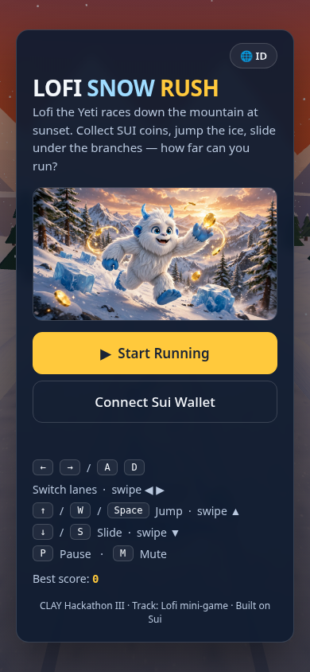
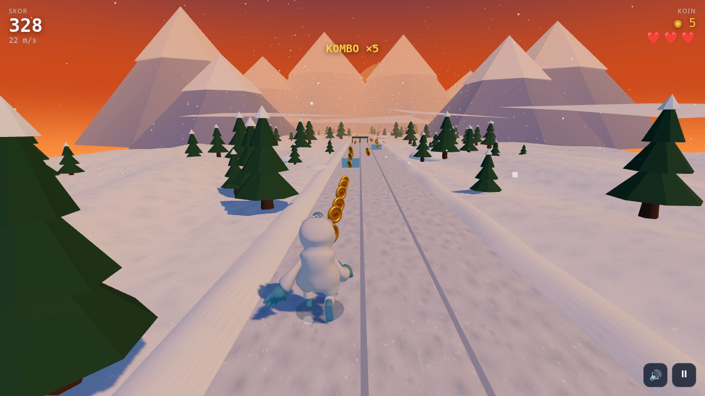
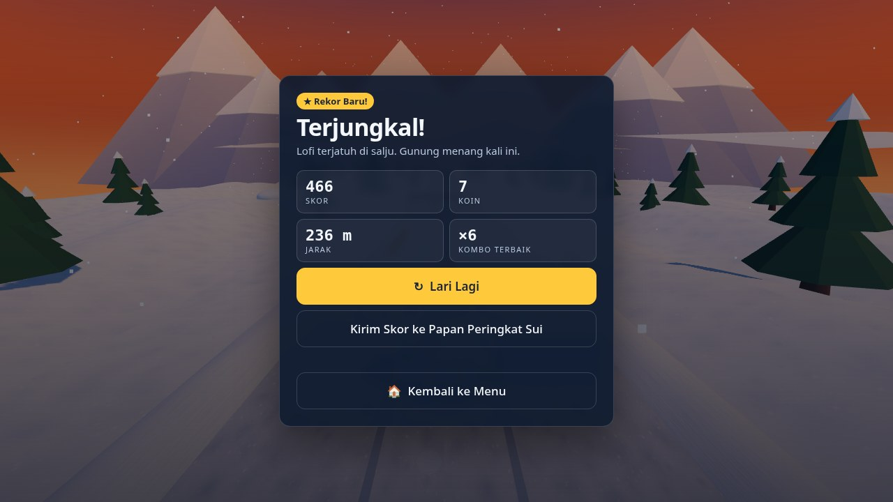
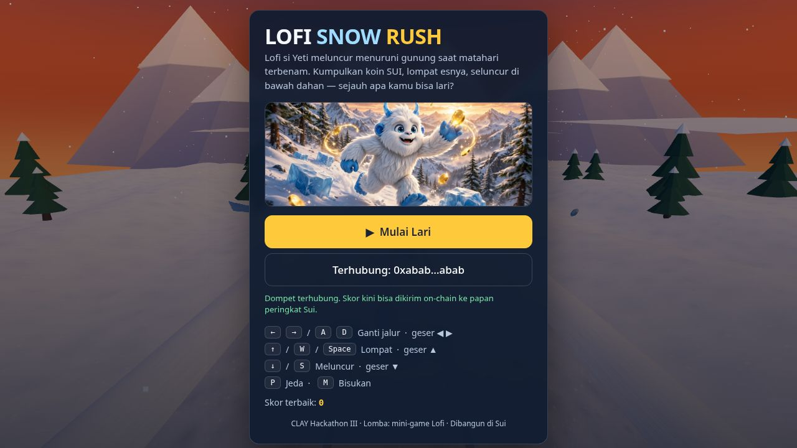

# LOFI SNOW RUSH

**A 3D endless runner starring Lofi the Yeti — race down a sunset mountain, grab SUI coins, and post your score on-chain.** Built for [CLAY Hackathon III](https://hackathon.lofitheyeti.com) (Lofi mini-game track).

🎮 **[Play now](https://maman19358.github.io/lofi-snow-rush/)** · 🎬 **[Demo video](https://youtu.be/A7TxtOeo2-E)**

| Start screen (English UI) | Gameplay |
|---|---|
|  |  |
| Game over — submit your score | Wallet connected |
|  |  |

## Features

- **Real 3D endless runner** (Three.js / WebGL) — no build step, no framework
- **3-lane dodging:** ice blocks, crevasses, low branches, ice rocks, snowmen, ice spikes
- **Coins with a combo multiplier** (up to ×8), a shield power-up, and 3 lives
- **Speed ramps 16 → 42 m/s**; score = distance + coin points
- **Keyboard and touch controls** — arrows / WASD / Space on desktop, swipe on mobile
- **Sui wallet connect** (Slush, via Wallet Standard) with an **on-chain leaderboard** on Sui testnet
- **Fully playable without a wallet** — scores fall back to a local top 10 on the device
- **Indonesian / English language toggle** (default Indonesian, choice saved on device)
- Synthesized WebAudio sound effects with a mute toggle; auto-pauses when the tab is hidden

## Controls

| Input | Action |
|---|---|
| ← → / A D · swipe ◀ ▶ | Switch lane |
| ↑ / W / Space · swipe ▲ | Jump |
| ↓ / S · swipe ▼ | Slide |
| P / Esc | Pause |
| M | Mute |
| Enter | Start / restart |

## On-chain (Sui testnet)

- Contract: `leaderboard::submit_score`
- Package ID: `0x743c045df0051a564be60b35b37d2a2936acc0a5d8e1843c144a3ac98deda280`
- Leaderboard object (shared): `0x6052e73abaa237e3ee7ec50961755a49bd3b95dfe23d723974cd6cb542fa95cb`
- Publish transaction: `5Zhn9kgQWErv6h2HcT1H7DdZq5hERhHWroRhwP4ug8Vd`

How it works: connect a Sui wallet → finish a run → submit the score from the game-over screen. The transaction calls `submit_score` with the shared board object and the score as a `u64`; the score is also always saved to the local top 10. Verified end-to-end in the real Slush in-app browser (Nov 2026): the wallet connects, scores submit on-chain, and the board reads back via Sui GraphQL.

## Tech stack

- Three.js (vendored, `vendor/three/three.module.min.js`) + plain ES modules — no bundler
- Custom GLB yeti model (`assets/Yeti.gltf`) and a procedural low-poly mountain world
- Sui: `@mysten/sui` + `@mysten/wallet-standard`, loaded lazily from esm.sh only when the player taps Connect — everything else runs locally
- Move leaderboard contract on Sui testnet

## Run locally

```bash
python3 -m http.server 8321
# open http://localhost:8321/
```

No install, no build — any static file server works.

## Hackathon

Built for **CLAY Hackathon III** — Lofi mini-game track. Submission: this repo, the [demo video](https://youtu.be/A7TxtOeo2-E), and the [live site](https://maman19358.github.io/lofi-snow-rush/).
